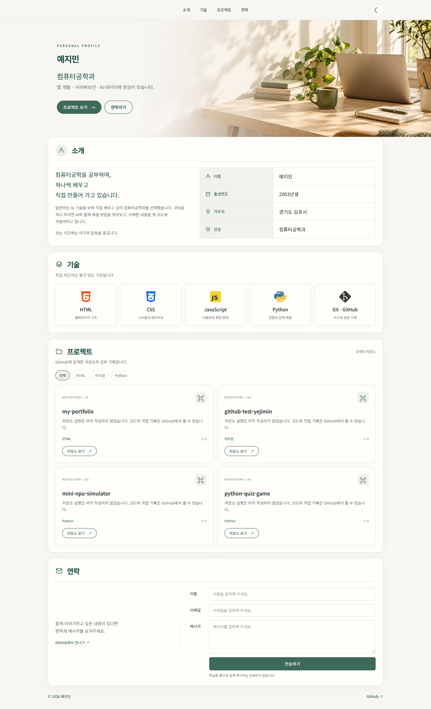
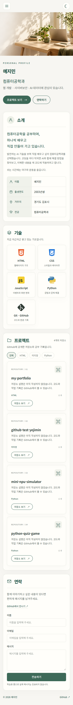
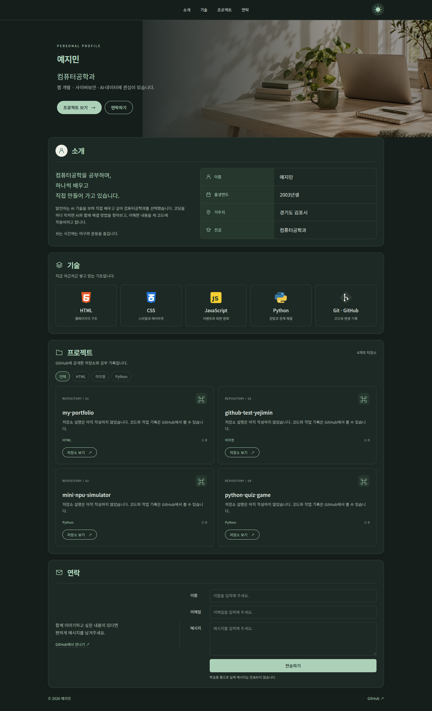

# 예지민의 포트폴리오

순수 HTML 구조, CSS 디자인, JavaScript 동작 으로 수정하고 관리하기 편하게 만든 반응형 자기소개 웹사이트입니다. 작은 이름, 따뜻한 아이보리 배경과 초록색 포인트로 기본 프로필과 공부 기록을 담았습니다.

## 링크

- 저장소: https://github.com/Yebook2/my-portfolio
- GitHub Pages 배포 후 사용할 주소: https://Yebook2.github.io/my-portfolio/
- 이 파일 묶음은 로컬 브라우저에서 검증했습니다. 실제 배포 여부는 저장소의 Settings → Pages에서 확인해야 합니다.

## 사용 기술

HTML5, CSS3, ES6+ JavaScript, GitHub REST API, LocalStorage, Intersection Observer. 외부 실행 라이브러리나 프레임워크, 빌드 도구를 사용하지 않습니다. Python은 소개하는 학습 기술이며 사이트 실행에는 사용하지 않습니다.

## 파일 구성

| 경로 | 역할 |
| --- | --- |
| index.html | Hero, About, Skills, Projects, Contact, Footer 시맨틱 구조 |
| css/style.css | 모바일 우선 레이아웃, CSS 변수, 테마와 애니메이션 |
| js/main.js | 이벤트 처리, 상태 변경, DOM 렌더링, API 호출, 폼 검증 |
| images/ | 책상 이미지, 프로필 이미지, 기술 아이콘 |
| images/screenshots/ | 데스크톱·모바일·다크 모드 스크린샷 |
| 코드설명.md | 코드 흐름과 평가 항목 설명 |
| 전체코드.md | 파일별 복사 가능한 전체 소스 |

## 실행

1. 압축을 풀고 `my-portfolio` 폴더를 VS Code로 엽니다.
2. VS Code 확장에서 Live Server를 설치합니다.
3. `index.html`을 오른쪽 클릭하고 **Open with Live Server**를 선택합니다.
4. 브라우저에서 보이는 주소로 접속합니다. npm 설치나 별도 빌드가 필요 없습니다.

## 구현한 기능

- 의미별 HTML 태그, 이미지 alt, label 연결, 키보드 포커스, 본문 바로가기
- Flexbox 네비게이션, Grid 프로젝트 카드, 768px·1024px 반응형 분기
- 모바일 햄버거 메뉴, 링크 선택·Escape·화면 크기 변경 시 닫기
- 부드러운 앵커 이동, 스크롤 60px 이상에서 헤더 배경 변경
- 스크롤 300px 이상에서 맨 위 버튼 표시
- 아이콘만 있는 다크 모드 버튼, LocalStorage 저장 및 새로고침 복원
- 저장된 설정이 없으면 처음 열 때 시스템 테마 감지
- Intersection Observer threshold 0.2로 섹션 진입 애니메이션
- 동작 줄이기를 설정한 브라우저에서는 애니메이션 생략
- GitHub 공개 저장소를 불러오는 로딩·성공·오류·빈 상태와 재시도
- map으로 프로젝트 카드 생성, filter로 언어별 목록 필터링
- 이름·이메일·메시지 필수 입력, 공백만 입력 방지, 이메일 형식 검사
- 입력 필드 근처 오류 표시와 올바른 입력 시 오류 해제

## 이벤트 → 상태 → 렌더링

| 사용자 동작 | 상태 변경 | 화면 반영 |
| --- | --- | --- |
| 테마 버튼 클릭 | state.theme | renderTheme으로 data-theme와 접근성 이름 변경 |
| API 요청·응답 | state.projectStatus, repos, apiError | renderProjects로 로딩·카드·오류·빈 화면 표시 |
| 언어 버튼 클릭 | state.language | renderProjects에서 filter 후 다시 카드 생성 |
| 폼 입력·제출 | state.errors, formMessage | renderForm에서 오류, aria-invalid, 완료 문구 표시 |
| 메뉴 버튼 클릭 | state.menuOpen | renderMenu에서 active 클래스와 aria-expanded 변경 |

## GitHub API

`js/main.js` 맨 위의 `GITHUB_USERNAME`은 `Yebook2`로 설정되어 있습니다.

요청 주소: `https://api.github.com/users/Yebook2/repos?sort=updated&direction=desc&per_page=100`

최근 수정순으로 공개 저장소를 최대 100개 가져옵니다. 비인증 요청은 기본 시간당 60회 제한이 있어 잦은 새로고침을 피합니다. 403·429 오류에는 호출 제한 안내와 재시도를 표시합니다. 인터넷 연결 실패와 404, 15초 시간 초과도 처리합니다. 비공개 저장소는 표시하지 않습니다. 저장소 이름과 설명은 HTML 문자 이스케이프 후 출력합니다. 저장소 설명이 없으면 기본 안내를 표시하며, 가짜 프로젝트는 추가하지 않습니다.

## 문의 폼

과제에서 실제 이메일 전송은 선택 과제입니다. 현재 폼은 입력 검증을 학습하기 위한 것으로, `전송하기`를 눌러도 서버나 이메일 서비스로 전송하지 않습니다. 성공 문구도 실제 전송하지 않았다는 사실을 알려줍니다. 사용자가 쓴 이름·이메일·메시지를 LocalStorage에 저장하지 않습니다.

## GitHub Pages 배포

1. https://github.com/Yebook2/my-portfolio 에서 파일을 올립니다.
2. 압축을 푼 `my-portfolio` 폴더 **안의 파일과 css, js, images 폴더**를 업로드합니다. 저장소 첫 화면에 `index.html`이 바로 있어야 합니다. ZIP 파일이나 바깥쪽 폴더 하나만 업로드하면 안 됩니다.
3. 기존 파일과 이름이 겹치면 새 버전으로 교체하고 Commit changes를 누릅니다.
4. Settings → Pages → Build and deployment로 들어갑니다.
5. Source는 `Deploy from a branch`, Branch는 `main`, 폴더는 `/(root)`를 선택한 뒤 Save합니다. 기본 브랜치 이름이 다르면 실제 파일을 올린 브랜치를 선택합니다.
6. 배포 완료 후 Pages에 표시되는 사이트 주소로 접속합니다.
7. 모바일 메뉴·다크 모드 유지·프로젝트 로딩·폼 오류를 실제 배포 주소에서도 확인합니다.
8. 배포가 확인되면 위 링크 설명을 실제 배포 URL로 정리하고, 필요하면 아래 스크린샷을 배포 화면에서 다시 촬영합니다.

같은 배포 브랜치의 파일을 수정해 커밋하면 다음 배포가 성공한 뒤 사이트에 반영됩니다. 로컬 컴퓨터 파일만 고치는 것으로는 GitHub 사이트가 바뀌지 않습니다.

공식 안내: https://docs.github.com/en/pages/getting-started-with-github-pages/configuring-a-publishing-source-for-your-github-pages-site

## 스크린샷

실제 로컬 실행 화면입니다. 프로젝트 카드는 촬영 시 GitHub API에서 가져온 공개 저장소입니다.

### 데스크톱

### 모바일

### 다크 모드

## 이미지

`images/study-desk.png`는 이미지 생성 기능으로 제작한 책상 이미지입니다. 제작 요청: “햇살 드는 아이보리 배경의 책상, 노트북·책·초록 식물·초록 머그컵, 글자와 로고 없이 차분한 가로 사진”. `images/profile.svg`는 소개 제목 옆에 표시하는 작은 인물 윤곽 프로필 이미지입니다. 실물 얼굴 사진은 포함하지 않았습니다. 아이콘은 로컬 SVG 파일이므로 외부 아이콘 서비스를 호출하지 않습니다.

## 제출 전 확인

- 저장소 URL과 실제 접속 가능한 GitHub Pages URL 제출
- 데스크톱·모바일·다크 모드 스크린샷 확인
- 본인 정보와 GitHub 아이디 확인
- 코드설명.md를 읽고 이벤트 → 상태 → 렌더링을 직접 설명
